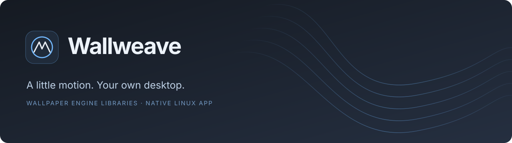
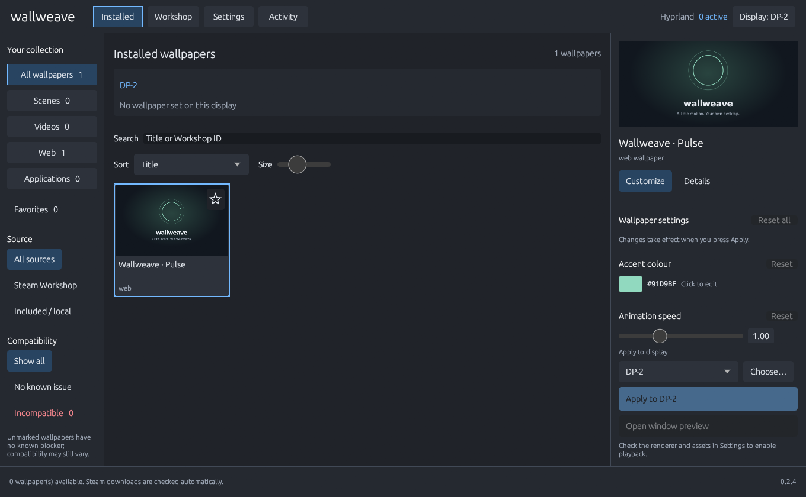

<div align="center">



**Your Wallpaper Engine library, at home on Linux.**

A native desktop app for finding, customizing and playing your wallpapers across displays.

[](https://github.com/MGCrafter/wallweave/releases/latest)
[](https://github.com/MGCrafter/wallweave/actions/workflows/ci.yml)
[](LICENSE)
[](docs/INSTALL.md)

[**Download for Linux**](https://github.com/MGCrafter/wallweave/releases/latest) · [Installation](docs/INSTALL.md) · [Deutsche Anleitung](docs/INSTALL.de.md) · [Usage & CLI](docs/USAGE.md) · [Report a bug](https://github.com/MGCrafter/wallweave/issues/new/choose)

</div>



*Actual native app, showing the original bundled Pulse demo. No Workshop artwork is included in the repository or downloads.*

## Make your desktop yours

| | |
| --- | --- |
| **Your collection, organized** | Thumbnail library, search, favorites, filters and sorting by actual Steam subscription date. |
| **Workshop built in** | Browse, subscribe and download through your running Steam client. No API key or password to enter. |
| **Every display has a choice** | Visual monitor picker, per-display assignments and double-click to apply. |
| **Tune the details** | Sliders, color pickers, checkboxes and grouped settings from each wallpaper's properties. |
| **Keep the motion going** | Wallpapers continue after closing the app. Saved assignments restore when you open it again. |
| **Native from the start** | Rust + egui, Wayland and X11 windows, bundled CJK font support and a complete CLI. |

Wallweave manages your library, settings and wallpaper processes. A separate `linux-wallpaperengine` renderer supplies scene, video and web playback. **This is early software:** individual scripts and desktop integrations vary in compatibility. Hyprland has received playback testing; see [tested behavior and known limits](docs/VALIDATION.md).

## Install on Linux

### Arch Linux, EndeavourOS & CachyOS

Download `wallweave-0.2.4-1-x86_64.pkg.tar.zst` from [Releases](https://github.com/MGCrafter/wallweave/releases/latest) and install the native package:

```sh
sudo pacman -U ./wallweave-0.2.4-1-x86_64.pkg.tar.zst
wallweave
```

Pacman installs the app, icon and menu entry and resolves runtime dependencies. The renderer is configured separately under [First launch](#first-launch). A checksum-pinned `PKGBUILD` is also provided with every release for `makepkg -si`.

Prebuilt downloads target **x86_64 Linux with glibc 2.35 or newer**, built on Ubuntu 22.04. You need your own Wallpaper Engine installation and assets; Workshop browsing requires the native Linux Steam client, signed in with an account that owns Wallpaper Engine. The renderer is installed separately below.

### AppImage

Download `Wallweave-0.2.4-x86_64.AppImage` from [Releases](https://github.com/MGCrafter/wallweave/releases/latest), then:

```sh
chmod +x Wallweave-0.2.4-x86_64.AppImage
./Wallweave-0.2.4-x86_64.AppImage
```

If FUSE is unavailable, run `./Wallweave-0.2.4-x86_64.AppImage --appimage-extract-and-run`.

### Portable archive and application-menu entry

Download `wallweave-0.2.4-linux-x86_64.tar.gz` from the same release:

```sh
tar -xzf wallweave-0.2.4-linux-x86_64.tar.gz
cd wallweave-0.2.4-linux-x86_64
./run.sh                         # Run directly, without installation.
python3 install.py               # Optional: install for your user, no sudo.
```

The installer adds **Wallweave** to your application menu and creates `~/.local/bin/wallweave`. Python 3.10+ is needed for the installer; running the app itself does not require Python. [Full installation, updates and uninstall instructions →](docs/INSTALL.md)

## First launch

1. **Install a renderer.** Use an existing `linux-wallpaperengine` executable, or download `install-renderer.py` from the release and run:

   ```sh
   python3 install-renderer.py --directory "$HOME/.local/share/wallweave/renderer"
   ```

   The optional installer downloads the pinned v0.9.4 renderer (about 267 MB), verifies its SHA-256 and prints the executable path. Select that executable in **Settings → Renderer**. It does not start a wallpaper.

2. **Connect your library.** Wallweave detects common Steam installations. For an external drive, use **Settings → Add Steam library** and select the folder containing `steamapps`. Set the Wallpaper Engine `assets` folder if it was not discovered.
3. **Choose a screen and wallpaper.** Select a monitor in the display picker, then choose a wallpaper and press **Apply to …**. Use **Open window preview** to try it in a window.
4. **Find more in Workshop.** Keep native Steam open, visit **Workshop**, search and choose **Download & subscribe**. Steam manages the files and updates.

Full screen pause, rendering features and compositor placement depend on your renderer. GNOME additionally needs the renderer's matching Shell extension. No desktop login autostart is configured automatically.

## Desktop support

| Desktop | Integration | Validation |
| --- | --- | --- |
| **Hyprland** | Native layer-shell | Video, scene and web playback, multiple outputs and pause/resume tested. |
| Sway / niri / similar | Renderer layer-shell | Session testing pending. |
| KDE Plasma | Renderer Plasma integration | Requires a compatible extended renderer; session testing pending. |
| GNOME | Renderer + matching Shell extension | Extension setup and session testing pending. |
| X11 | Renderer desktop output | Session testing pending. |

Unmarked wallpapers have no known blocker; they are not guaranteed to render correctly. Presets requiring a separate base wallpaper and Windows application wallpapers are currently unsupported.

## A CLI when you need it

After installing the archive, use `wallweave` (or `~/.local/bin/wallweave` if your shell does not include that directory):

```sh
wallweave doctor
wallweave scan
wallweave workshop search "forest"
wallweave config add-library "/mnt/your-drive/SteamLibrary"
wallweave apply 1234567890 --output DP-1  # Replace with your wallpaper ID and connector.
wallweave pause --output DP-1
wallweave resume --output DP-1
wallweave shutdown                     # Stop Wallweave's wallpaper processes.
```

[All commands, library behavior and troubleshooting →](docs/USAGE.md)

## Build from source

Install a current stable Rust toolchain, a C compiler, `pkg-config` and the Wayland/XKB/EGL development libraries. On Ubuntu/Debian:

```sh
sudo apt-get install build-essential pkg-config libwayland-dev libxkbcommon-dev libegl1-mesa-dev libgl1-mesa-dev libdbus-1-dev libudev-dev

git clone https://github.com/MGCrafter/wallweave.git
cd wallweave
python3 scripts/build-app.py
./run.sh
```

Rust 1.88 is the package's declared minimum; release builds use current stable Rust and the committed lockfile. To build only the CLI, run `cargo build --release --locked --no-default-features`. [Linux packaging and release workflow →](docs/RELEASING.md)

```sh
cargo fmt --check
cargo test --locked --all-targets
cargo clippy --locked --all-targets -- -D warnings
cargo check --locked --no-default-features
```

Tests use isolated state and fake renderers. The automated suite does not change your desktop wallpaper.

## Documentation & contributing

[Install & troubleshoot](docs/INSTALL.md) · [Deutsch](docs/INSTALL.de.md) · [Full usage guide](docs/USAGE.md) · [Architecture](docs/ARCHITECTURE.md) · [Validation](docs/VALIDATION.md) · [Contributing](CONTRIBUTING.md)

Bug reports are most useful with your desktop, Wallweave version, `wallweave doctor --json`, and an affected Workshop link or ID. Remove private paths from diagnostics before posting. Please report rendering differences separately from library or interface problems.

## License & credits

Wallweave's original code is **[MIT licensed](LICENSE)**. Built with [Rust](https://www.rust-lang.org/), [egui](https://github.com/emilk/egui) and [steamworks-rs](https://github.com/Noxime/steamworks-rs). Noto Sans CJK is included under the [SIL Open Font License](assets/fonts/OFL.txt); the Steamworks runtime retains Valve's terms. Release archives include dependency license notices.

The optional renderer is [linux-wallpaperengine-kde](https://github.com/WallpaperEngineLover/linux-wallpaperengine-kde), based on [linux-wallpaperengine](https://github.com/Almamu/linux-wallpaperengine), and retains its own GPL and third-party licenses. See [third-party components](docs/THIRD_PARTY.md).

Wallpaper Engine and Steam are trademarks of their respective owners. Wallweave is an independent community project and is not affiliated with or endorsed by Valve or the Wallpaper Engine developers. No Wallpaper Engine assets or third-party Workshop wallpapers are bundled.
